# carhealth.

**Tu coche, en orden.**

Aplicación web _mobile-first_ y _offline-first_ para llevar el control real de un coche: repostajes, consumo, coste por kilómetro, mantenimiento, recambios, ahorro por gasolinera y libro de mantenimiento en PDF.

No es una hoja de cálculo con otro nombre: calcula lo que de verdad gasta el coche, compara tus repostajes contigo mismo y te deja apuntar un repostaje aunque estés en un parking sin cobertura.


---

## Índice

- [Qué incluye](#qué-incluye)
- [Stack técnico](#stack-técnico)
- [Arquitectura](#arquitectura)
- [Puesta en marcha en local](#puesta-en-marcha-en-local)
- [Cuenta de demostración](#cuenta-de-demostración)
- [Funcionamiento offline](#funcionamiento-offline)
- [Tests](#tests)
- [API REST](#api-rest)
- [Lógica de negocio](#lógica-de-negocio)
- [Capturas](#capturas)
- [Despliegue con Docker](#despliegue-con-docker)
- [Estructura del proyecto](#estructura-del-proyecto)
- [Seguridad y mantenimiento](#seguridad-y-mantenimiento)

---

## Qué incluye

### Garaje
- Alta, edición y eliminación de vehículos.
- Datos técnicos: marca, modelo, año, matrícula, VIN, código de motor, combustible, color, fecha y precio de compra.
- Foto real del coche, optimizada en el navegador y mostrada en el hero verde del dashboard y del garaje.
- Kilometraje actual y cambio rápido de vehículo activo.
- Plan de mantenimiento preventivo creado automáticamente para cada coche.

### Cuentas y acceso
- Registro con **verificación de correo obligatoria**.
- Código numérico de 6 dígitos, guardado como hash y válido durante **10 minutos**.
- Reenvío con límite de 60 segundos y máximo de 5 intentos por código.
- Correo HTML responsive, en español o inglés según el idioma activo, con código, caducidad y aviso de seguridad.
- El login queda bloqueado hasta que el correo esté verificado; la verificación correcta inicia sesión automáticamente.
- La cuenta demo se crea directamente verificada.

### Idiomas
- Interfaz completa en **español e inglés**, con selector en la cabecera, el login y las preferencias del garaje.
- Todos los textos viven en diccionarios JSON (`es.json` y `en.json`), incluidos botones, formularios, placeholders, aria-labels, avisos y errores.
- La preferencia se guarda en el dispositivo y se aplica también a fechas, números, monedas, gráficas y categorías.
- Los dos diccionarios se validan con un test de paridad de claves.

### Repostajes
- Registro de fecha, odómetro, litros, precio por litro, importe total, gasolinera y ubicación.
- Selector de fecha y hora propio en español e inglés, con calendario, navegación por meses y edición de hora, sin el control nativo del navegador.
- Búsqueda real de gasolineras, talleres y direcciones con OpenStreetMap/Photon.
- Categorías y tipos de lugar traducidos al idioma activo (gasolinera, taller, concesionario, ciudad, pico…).
- Botón **«Usar mi ubicación»** para pedir permiso al navegador, obtener las coordenadas y rellenar la dirección.
- Cálculo automático del **gasto** y del **consumo real entre depósitos llenos**.
- Comparación del precio pagado con la media histórica de esa estación y con el repostaje anterior.
- Ahorro estimado por repostaje y acumulado.
- Historial agrupado por mes, con litros, precio unitario, consumo y ahorro.
- Aviso de depósito parcial: los repostajes parciales no falsean el consumo.

### Mantenimiento
- Intervenciones preventivas, correctivas, mejoras y trámites legales.
- Mano de obra, recambios con referencia OEM, marca, cantidad y precio unitario.
- Vinculación de una intervención al plan preventivo para actualizar su próximo vencimiento.
- Estado del plan: **al día**, **próximo**, **vencido** o **sin datos**, calculado por kilómetros y por tiempo.
- Historial con coste desglosado y notas.
- **Dossier PDF** descargable con los datos del coche y su mantenimiento.

### Análisis
- KPIs del mes y de los últimos 30 días.
- Gasto de combustible y taller en los últimos 12 meses.
- Consumo real, evolución de precios y comparativa de gasolineras.
- Coste por kilómetro, litros repostados y ahorro acumulado.
- Dashboard con próximos mantenimientos y movimientos recientes.

### Experiencia
- Interfaz en español, responsive y pensada primero para el móvil.
- Tema claro y oscuro persistente.
- Instalable como PWA con iconos propios.
- Sin cobertura: los repostajes e intervenciones se guardan en el dispositivo y se sincronizan al volver la conexión.

---

## Stack técnico

| Capa | Tecnología |
| --- | --- |
| Backend | Java 21, Spring Boot 4.1.2, Spring MVC, Spring Data JPA, Spring Security |
| Autenticación | JWT HS256, BCrypt, API _stateless_ |
| Correo | Spring Mail + SMTP; Mailpit opcional en local y código en el log |
| Base de datos | PostgreSQL 17 en Docker; H2 en modo PostgreSQL para desarrollo local |
| Migraciones | Flyway (`V1__init_schema.sql`, `V2__vehicle_photo.sql`) |
| Geocodificación | Photon / OpenStreetMap + geolocalización del navegador |
| Documentación | Springdoc OpenAPI 3 + Swagger UI |
| PDF | OpenPDF |
| Frontend | Angular 22, standalone components, Signals, zoneless |
| Idiomas | Español e inglés con diccionarios JSON, pipe `t` y `I18nService` |
| Estilos | Tailwind CSS 4, diseño propio con Plus Jakarta Sans |
| Estado offline | Angular Service Worker + IndexedDB (`idb`) |
| Tests | JUnit 5 + MockMvc; Vitest mediante el builder de Angular |
| Despliegue | Docker multi-stage, Nginx, Caddy con SSL automático |

---

## Arquitectura

```text
┌─────────────────────────────────────────────────────────────┐
│                         Navegador                           │
│  Angular 22 · Signals · Tailwind · PWA · IndexedDB          │
│                                                             │
│  GET  ──► caché IndexedDB ◄── service worker (app shell)    │
│  POST ──► cola offline ──► reintento con idempotencia       │
└───────────────────────────┬─────────────────────────────────┘
                            │ HTTPS · JWT Bearer
┌───────────────────────────▼─────────────────────────────────┐
│                    Caddy (SSL automático)                    │
│         /api/* · /swagger-ui* · /v3/api-docs*               │
└───────────────┬─────────────────────────────┬───────────────┘
                │                             │
┌───────────────▼──────────────┐  ┌───────────▼───────────────┐
│  Spring Boot 4               │  │  Nginx + build Angular    │
│  Controller → Service → Repo │  │  SPA + assets + PWA       │
│  JWT · OpenAPI · PDF         │  └───────────────────────────┘
└───────────────┬──────────────┘
                │ JDBC
┌───────────────▼──────────────┐
│  PostgreSQL 17 + Flyway      │
│  Volumen persistente         │
└──────────────────────────────┘
```

El backend es una API sin estado: no guarda sesión en servidor. Cada petición protegida lleva `Authorization: Bearer <token>`, de modo que la misma API puede consumirse desde la web Angular, una futura app Kotlin o cualquier otro cliente.

---

## Puesta en marcha en local

### Requisitos

- **JDK 21** o superior.
- **Node.js 24 LTS** y npm (Angular 22 también funciona con Node 22 reciente).
- No hace falta PostgreSQL para desarrollo: el backend usa H2 en un archivo local.
- Docker y el plugin `docker compose` solo son necesarios para el despliegue.

### 1. Backend

```bash
cd backend
./mvnw spring-boot:run
```

La primera ejecución crea `dbconfig/h2/carhealth.mv.db`, aplica Flyway y siembra los datos de demostración.

- API: <http://localhost:8080/api/v1>
- Swagger UI: <http://localhost:8080/swagger-ui.html>
- OpenAPI JSON: <http://localhost:8080/v3/api-docs>
- Healthcheck: <http://localhost:8080/api/v1/health>
- Healthcheck de Spring: <http://localhost:8080/actuator/health>
- Consola H2 (solo local): <http://localhost:8080/h2-console>

### 2. Frontend

En otra terminal:

```bash
cd frontend
npm install
npm start
```

Abre <http://localhost:4200>. El servidor de desarrollo redirige `/api` al backend en el puerto 8080 mediante `proxy.conf.json`.

### 3. Cuenta de demostración

| Campo | Valor |
| --- | --- |
| Correo | `demo@carhealth.app` |
| Contraseña | `demo1234` |

En desarrollo aparece además el botón **«Explorar con el garaje de Marta»** en la pantalla de acceso, que entra directamente con esta cuenta.

La cuenta demo incluye un Seat León 2021 («El León»), 18 repostajes repartidos por un año, cuatro intervenciones de mantenimiento y su plan preventivo.

### 4. Reiniciar los datos de demo

El seeder solo actúa si el usuario demo no existe. Para dejarlo todo limpio:

```bash
# Detén el backend con Ctrl+C
cd backend
rm -f ../dbconfig/h2/carhealth.*.db
./mvnw spring-boot:run
```

También puedes arrancar sin datos de demo:

```bash
DEMO_DATA=false ./mvnw spring-boot:run
```

### Correo de verificación en local con Mailpit

Mailpit es un servidor SMTP de pruebas: captura los correos en una bandeja local, pero **no los envía a Internet**. Es suficiente para probar el código de 6 dígitos y revisar el HTML real del correo.

La forma más cómoda en este proyecto es usar el script incluido, que no necesita Docker:

```bash
./scripts/mailpit.sh
```

- Bandeja web: <http://127.0.0.1:8025>
- SMTP para el backend: `127.0.0.1:1025`

En VS Code, selecciona la configuración **Backend + Mailpit** al arrancar el backend. Esa configuración activa el envío SMTP local y apunta a Mailpit. Si el backend ya estaba arrancado, reinícialo.

Si lo arrancas desde una terminal:

```bash
cd backend
MAIL_ENABLED=true MAIL_HOST=127.0.0.1 MAIL_PORT=1025 ./mvnw spring-boot:run
```

También puedes arrancar Mailpit con Docker:

```bash
docker run --rm \
  -p 127.0.0.1:1025:1025 \
  -p 127.0.0.1:8025:8025 \
  axllent/mailpit:v1.34.0
```

Con Docker Compose, el servicio está en el perfil `mail` y solo se levanta cuando lo pides:

```bash
docker compose --profile mail up -d mailpit
```

En ese caso, si el backend también corre dentro de Compose, usa `MAIL_HOST=mailpit`; si corre en tu máquina, usa `MAIL_HOST=127.0.0.1`.

Para enviar correos reales, cambia a un proveedor SMTP y verifica el dominio remitente. Lo tienes explicado en [Despliegue con Docker](#despliegue-con-docker).

### Variables de entorno útiles en local

| Variable | Por defecto | Uso |
| --- | --- | --- |
| `PORT` | `8080` | Puerto del backend |
| `DB_URL` | H2 en `../dbconfig/h2/carhealth` (desde `backend/`) | URL JDBC; en Docker apunta a PostgreSQL |
| `DB_USERNAME` | `sa` | Usuario de base de datos |
| `DB_PASSWORD` | vacío | Contraseña de base de datos |
| `JWT_SECRET` | secreto de desarrollo | Firma de los JWT; cámbialo fuera de local |
| `JWT_EXPIRATION_DAYS` | `30` | Duración del token en días |
| `DEMO_DATA` | `true` | Crea la cuenta demo al arrancar |
| `CORS_ORIGINS` | `http://localhost:4200` | Orígenes permitidos, separados por comas |
| `SPRINGDOC_ENABLED` | `true` | Activa Swagger y OpenAPI |
| `H2_CONSOLE` | `true` | Activa la consola H2 |
| `MAIL_ENABLED` | `false` | Si es `false`, el código de verificación se escribe en el log del backend |
| `MAIL_HOST` | `localhost` | Servidor SMTP |
| `MAIL_PORT` | `1025` | Puerto SMTP |
| `MAIL_USERNAME` / `MAIL_PASSWORD` | vacío | Credenciales SMTP |
| `MAIL_SMTP_AUTH` / `MAIL_SMTP_STARTTLS` | `false` | Autenticación y STARTTLS del servidor SMTP |
| `MAIL_FROM` / `MAIL_FROM_NAME` | `no-reply@carhealth.local` / `Car Health` | Remitente del correo |

---

## Funcionamiento offline

La app está diseñada para que perder cobertura no te haga perder un repostaje.

1. **App shell**: el service worker de Angular precarga HTML, CSS, JS, fuentes e iconos. Si ya has abierto la app, puedes recargarla sin conexión.
2. **Lecturas**: el interceptor de `offline-cache` guarda en IndexedDB las respuestas GET por usuario y vehículo. Si la red falla, se sirve la última copia disponible y se muestra el aviso de modo offline.
3. **Escrituras**: si guardas un repostaje o una intervención sin conexión, la petición se guarda en una cola persistente con una vista previa. La UI la muestra como **pendiente**.
4. **Sincronización**: al recuperar la conexión, la cola se reproduce en orden. Cada mutación lleva un `clientMutationId`; el backend lo usa para no crear duplicados si el reintento se cruza con una respuesta perdida.
5. **Aislamiento**: las respuestas y la cola se filtran por usuario, de modo que cerrar sesión o cambiar de cuenta no mezcla datos.
6. **Estado real de conexión**: además de los eventos `online`/`offline` del navegador, la app consulta `GET /api/v1/health` cada 10 segundos. Así detecta también cuando hay red pero el backend no responde, y muestra «Sin conexión» o «Servidor no disponible» en lugar de un falso «En línea».

Los elementos pendientes se pueden reintentar o descartar desde la interfaz. Las operaciones que no son de creación (editar o borrar un coche, por ejemplo) requieren conexión. La búsqueda de lugares y el geocodificado inverso necesitan red; el resto de la app sigue funcionando con la copia local.

La estrategia se verificó con una build de producción y Playwright: recarga offline con service worker, alta de repostaje sin red, sincronización automática al volver online y creación de un único registro en el servidor.

---

## Diccionario de textos

La interfaz no contiene textos literales: todo pasa por `frontend/src/app/i18n/es.json` y `en.json`. Las claves son planas y compartidas por ambos idiomas:

```json
{
  "dashboard.emptyTitle": "Tu garaje está esperando.",
  "dashboard.vehicleToday": "Así va {vehicle} hoy.",
  "maintenance.partsCount.one": "1 recambio",
  "maintenance.partsCount.other": "{count} recambios"
}
```

En las plantillas se usa el pipe `t`; para textos generados en TypeScript se inyecta `I18nService`:

```html
<h1>{{ 'dashboard.emptyTitle' | t }}</h1>
<p>{{ 'dashboard.vehicleToday' | t: { vehicle: vehicle.name } }}</p>
```

```ts
this.toast.success(this.i18n.t('garage.toastUpdated'));
```

`I18nService` guarda la preferencia en `localStorage`, actualiza `<html lang>`, el título y la meta descripción, y propaga el idioma a fechas, números, moneda y etiquetas. Para añadir otro idioma basta con crear su JSON, registrarlo en `core/i18n.ts` y añadir la opción al selector.

---

## Tests

### Backend

```bash
cd backend
./mvnw test
```

El test de integración `ApiFlowIntegrationTest` levanta la aplicación con H2 en memoria y cubre, entre otras cosas:

- registro, verificación por correo, login con JWT y rechazo de credenciales incorrectas;
- códigos de verificación caducados, intentos incorrectos y reenvío con cooldown;
- creación de vehículo y generación automática de su plan preventivo;
- alta de repostajes, consumo full-to-full y resumen de ahorro;
- idempotencia de mutaciones offline y aislamiento de datos entre usuarios;
- intervenciones con recambios y actualización del odómetro;
- dashboard, estadísticas y dossier PDF;
- validación de peticiones, borrado de vehículos y correo duplicado.

### Frontend

```bash
cd frontend
npm test
```

Incluye tests de las utilidades de formato (euros, kilómetros, fechas, etiquetas y estados), de la priorización de resultados de la búsqueda de lugares, del selector de fecha y hora y de la paridad de claves entre los diccionarios de idioma con Vitest.

### Build de producción

```bash
cd frontend
npm run build
```

El resultado queda en `frontend/dist/frontend/browser`, que es exactamente lo que copia la imagen de Nginx.

---

## API REST

Todas las rutas, salvo registro, login, verificación de correo, reenvío de código y healthcheck, requieren la cabecera:

```http
Authorization: Bearer <token>
```

### Estado del servicio

| Método | Ruta | Descripción |
| --- | --- | --- |
| `GET` | `/api/v1/health` | Healthcheck público de la API |

### Autenticación

| Método | Ruta | Descripción |
| --- | --- | --- |
| `POST` | `/api/v1/auth/register` | Crea la cuenta y envía el código de verificación (sin JWT todavía) |
| `POST` | `/api/v1/auth/verify-email` | Verifica el código, activa la cuenta y devuelve JWT + usuario |
| `POST` | `/api/v1/auth/resend-verification` | Reenvía el código con límite de 60 segundos |
| `POST` | `/api/v1/auth/login` | Inicia sesión; devuelve 403 si el correo no está verificado |
| `GET` | `/api/v1/auth/me` | Perfil del usuario autenticado |
| `PATCH` | `/api/v1/auth/me` | Actualiza el nombre visible |
| `POST` | `/api/v1/auth/change-password` | Cambia la contraseña |

`POST /auth/register` devuelve `verificationRequired`, `email`, `expiresInSeconds` y `resendAfterSeconds`, pero **no un JWT**. `POST /auth/verify-email` devuelve el JWT y el usuario cuando el código es correcto. Si se intenta entrar con una cuenta sin verificar, el login responde `403` con `verificationRequired: true` y los segundos restantes de código y reenvío.

### Vehículos y análisis

| Método | Ruta | Descripción |
| --- | --- | --- |
| `GET` | `/api/v1/vehicles` | Garaje del usuario |
| `POST` | `/api/v1/vehicles` | Añade un vehículo |
| `GET` | `/api/v1/vehicles/{id}` | Detalle del vehículo |
| `PUT` | `/api/v1/vehicles/{id}` | Actualiza el vehículo |
| `DELETE` | `/api/v1/vehicles/{id}` | Elimina el vehículo y sus datos |
| `GET` | `/api/v1/vehicles/{id}/dashboard` | KPIs, próximos mantenimientos y actividad |
| `GET` | `/api/v1/vehicles/{id}/stats` | Series mensuales, consumo, precios y estaciones |
| `GET` | `/api/v1/vehicles/{id}/dossier.pdf` | Libro de mantenimiento en PDF |

### Repostajes

| Método | Ruta | Descripción |
| --- | --- | --- |
| `GET` | `/api/v1/vehicles/{id}/fuel-logs` | Historial de repostajes |
| `POST` | `/api/v1/vehicles/{id}/fuel-logs` | Registra un repostaje y calcula consumo/ahorro |
| `GET` | `/api/v1/vehicles/{id}/fuel-logs/stats` | Totales y series para gráficas |

Ejemplo de alta:

```json
{
  "date": "2026-11-12T18:15:00",
  "odometer": 48320,
  "liters": 39.9,
  "pricePerLiter": 1.515,
  "totalCost": 60.45,
  "stationName": "Ballenoil",
  "stationLocation": "Ballenoil · Leganés",
  "fullTank": true,
  "boardComputerAvg": 6.1,
  "clientMutationId": "7f6f20d4-7d3d-4a6e-9d0f-2f6b6a5c1e21"
}
```

La respuesta incluye `consumption` y un objeto `savings` con el precio de referencia, el ahorro unitario, el ahorro total y un mensaje listo para mostrar.

### Mantenimiento

| Método | Ruta | Descripción |
| --- | --- | --- |
| `GET` | `/api/v1/vehicles/{id}/maintenance-rules` | Plan preventivo con estado y próximos vencimientos |
| `POST` | `/api/v1/vehicles/{id}/maintenance-rules` | Añade una regla al plan |
| `DELETE` | `/api/v1/vehicles/{id}/maintenance-rules/{ruleId}` | Elimina una regla |
| `GET` | `/api/v1/vehicles/{id}/service-records` | Historial de intervenciones |
| `POST` | `/api/v1/vehicles/{id}/service-records` | Registra intervención, mano de obra y recambios |

Los errores se devuelven como `ProblemDetail` (`application/problem+json`) con `status`, `title` y `detail`, y errores de validación en `errors`.

La documentación interactiva completa está en **Swagger UI**: `/swagger-ui.html`.

---

## Lógica de negocio

### Ahorro por gasolinera

Al registrar un repostaje se elige un precio de referencia:

1. Si hay repostajes previos en la **misma estación**, se usa su media ponderada por litros.
2. Si no hay historial de esa estación, se usa el **repostaje anterior** del vehículo.
3. Si es el primero, no hay comparación todavía.

```text
ahorro unitario = precio de referencia − precio actual
ahorro total    = ahorro unitario × litros actuales
% más barato    = ahorro unitario / precio de referencia × 100
```

El resultado se devuelve en `savings` y se muestra en la UI como «Has echado un 4,2 % más barato que la media de esta gasolinera».

### Consumo real full-to-full

Solo se calcula entre depósitos completos:

```text
consumo = litros repostados desde el último depósito completo
          ────────────────────────────────────────────────────
          diferencia de odómetro entre ambos depósitos completos
```

Los repostajes parciales intermedios suman litros, pero no se usan como punto de corte. Así el consumo no se dispara artificialmente al llenar medio depósito.

### Mantenimiento preventivo

Cada regla define un intervalo en kilómetros, en meses o ambos. El backend calcula el próximo vencimiento a partir de la última intervención vinculada (o de la línea base del vehículo) y devuelve:

- `remainingKm` y `remainingDays`;
- estado `OVERDUE`, `DUE_SOON`, `OK` o `UNKNOWN`;
- próxima fecha y próximo kilómetro.

La UI muestra los vencidos y próximos en el dashboard y en la pantalla de mantenimiento.

### Idempotencia offline

`FuelLogRequest` y `ServiceRecordRequest` aceptan `clientMutationId`. Antes de insertar, el servicio busca ese identificador; si ya existe, devuelve el registro existente en lugar de duplicarlo. Es la pieza que hace segura la reproducción de la cola offline.

---

## Capturas

### Escritorio

| Dashboard | Repostajes |
| --- | --- |
|  |  |

| Estadísticas | Mantenimiento |
| --- | --- |
| 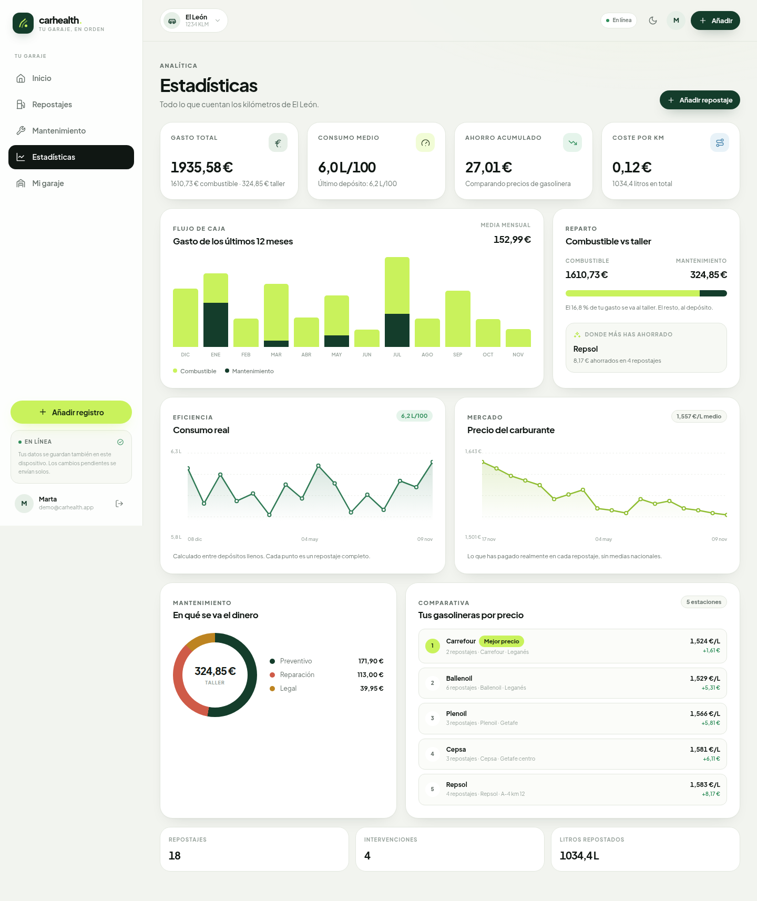 | 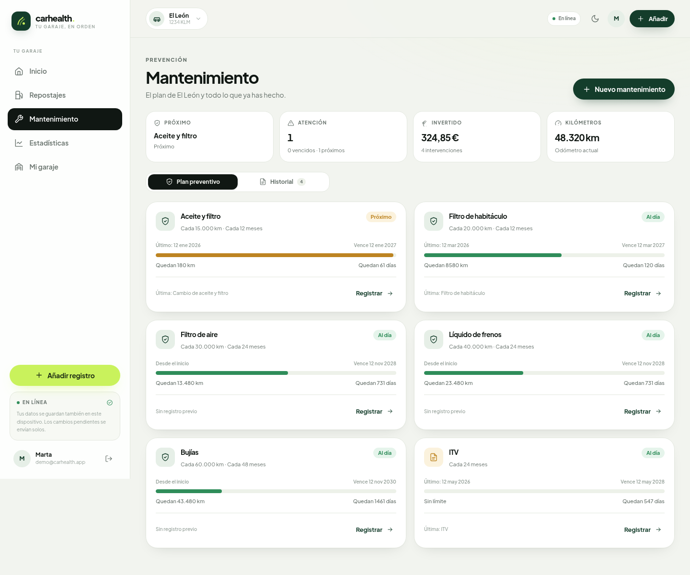 |

| Nuevo repostaje | Mi garaje |
| --- | --- |
| 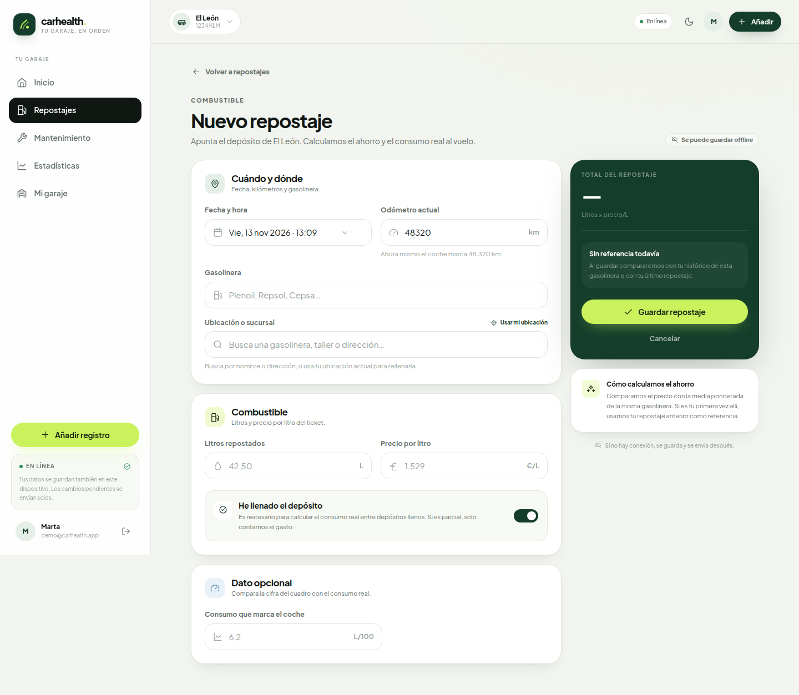 | 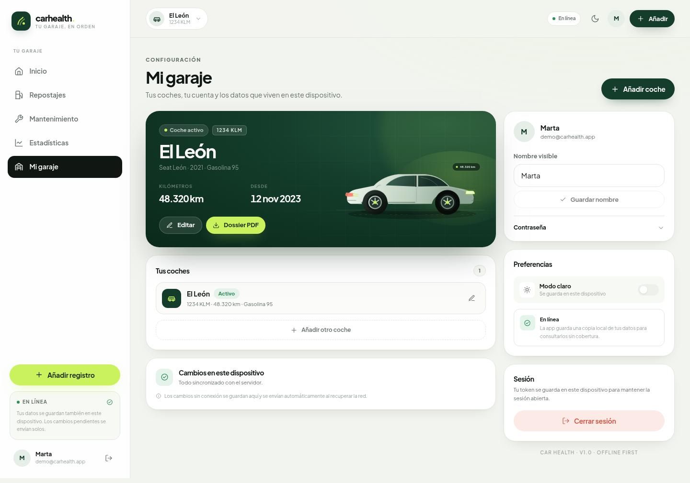 |

### Móvil

| Dashboard | Repostajes | Estadísticas |
| --- | --- | --- |
| 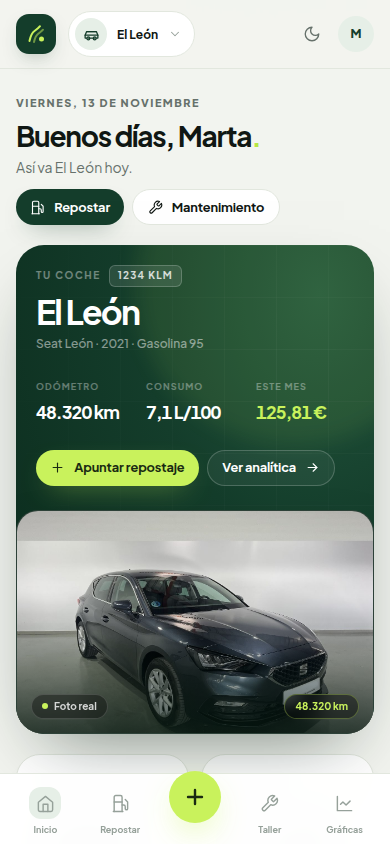 | 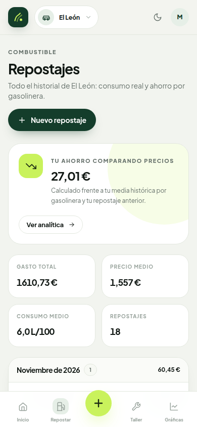 | 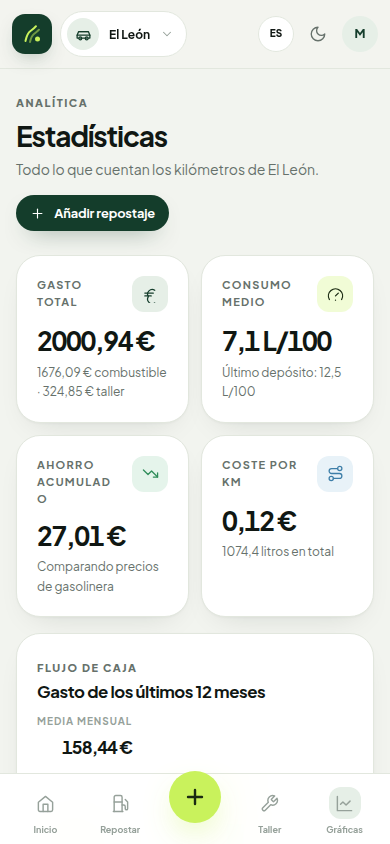 |

### Interfaz en inglés

El selector **ES / EN** cambia toda la aplicación al instante y recuerda la preferencia en el dispositivo.

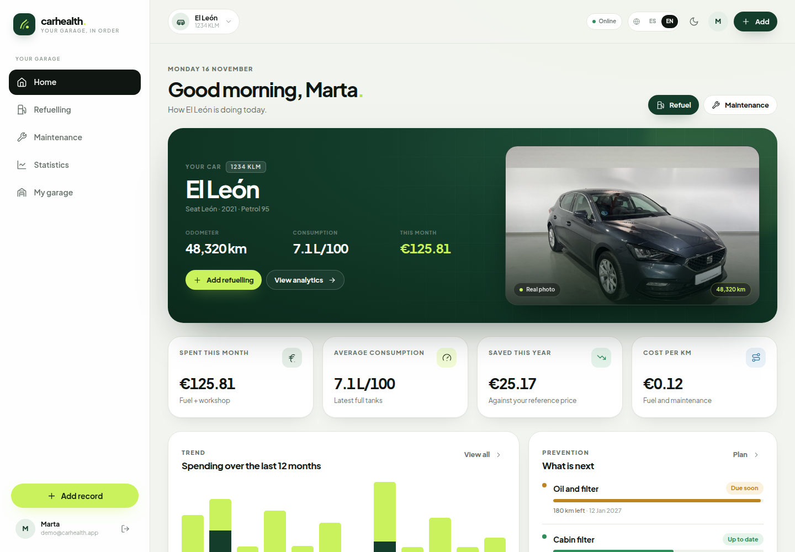

### Verificación de correo

La cuenta se activa introduciendo el código de 6 dígitos recibido. El código caduca a los 10 minutos y el correo se adapta al idioma activo.

| Pantalla de verificación | Correo HTML |
| --- | --- |
| 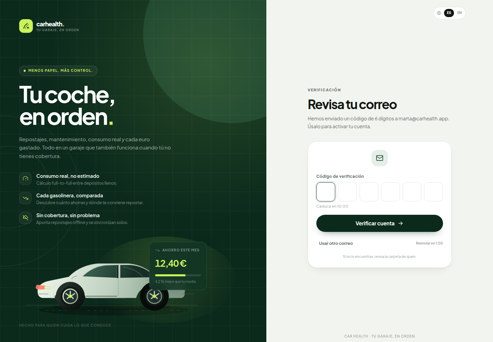 | 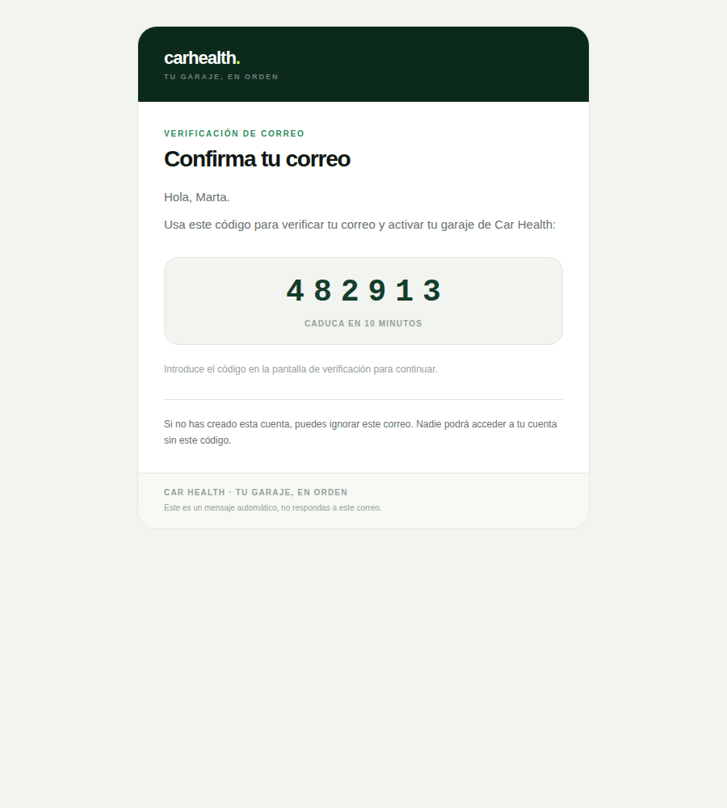 |

### Búsqueda de ubicación real

Al escribir el nombre de una gasolinera, taller o dirección, la app consulta OpenStreetMap/Photon y muestra coincidencias con su dirección. El botón **«Usar mi ubicación»** pide permiso al navegador y rellena la ubicación actual.

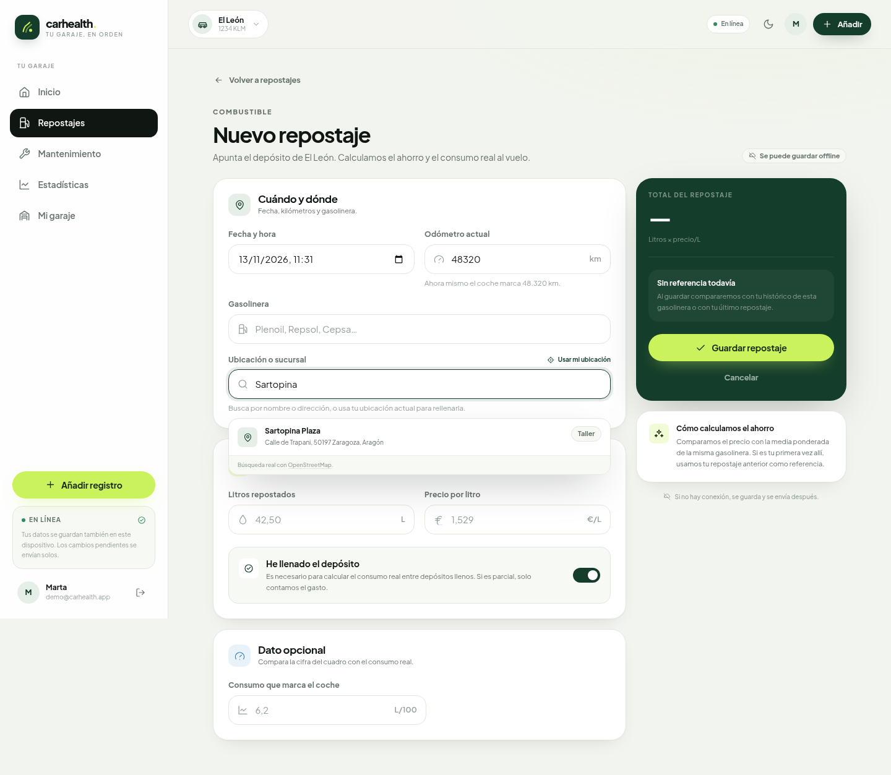

---

## Despliegue con Docker

El repositorio incluye una stack completa: PostgreSQL, backend, frontend y Caddy como proxy inverso con HTTPS automático.

### 1. Preparar el entorno

```bash
cp .env.example .env
openssl rand -base64 48   # úsalo como POSTGRES_PASSWORD
openssl rand -base64 48   # úsalo como JWT_SECRET
```

Edita `.env`:

```dotenv
POSTGRES_DB=carhealth
POSTGRES_USER=carhealth
POSTGRES_PASSWORD=<secreto-largo>
JWT_SECRET=<secreto-de-al-menos-32-bytes>
JWT_EXPIRATION_DAYS=30

# Producción con dominio y HTTPS automático:
SITE_ADDRESS=carhealth.tudominio.com

# En local/pruebas por HTTP:
# SITE_ADDRESS=http://localhost

DEMO_DATA=false
# Ponlo a false si no quieres Swagger público:
SPRINGDOC_ENABLED=true
CORS_ORIGINS=http://localhost

# Correo real de verificación (ejemplo con un SMTP estándar):
MAIL_ENABLED=true
MAIL_HOST=smtp.tu-proveedor.com
MAIL_PORT=587
MAIL_USERNAME=<usuario-smtp>
MAIL_PASSWORD=<contraseña-smtp>
MAIL_SMTP_AUTH=true
MAIL_SMTP_STARTTLS=true
MAIL_SMTP_SSL=false
MAIL_FROM=no-reply@tudominio.com
MAIL_FROM_NAME=Car Health
```

En local puedes dejar `MAIL_ENABLED=false`: el backend escribe el código de 6 dígitos en su log para que puedas completar el registro sin configurar SMTP. Para revisar el correo HTML sin enviarlo a Internet, usa [Mailpit](#correo-de-verificación-en-local-con-mailpit).

> `DEMO_DATA=false` evita crear la cuenta demo en producción. Si quieres enseñar la app con datos de ejemplo, cámbialo a `true` solo en un entorno controlado.

### 2. Levantar la stack

```bash
docker compose up -d --build
```

Servicios:

| Servicio | Función | Puerto |
| --- | --- | --- |
| `caddy` | Entrada HTTP/HTTPS, proxy y certificados | `80`, `443` |
| `frontend` | Nginx con el build de Angular | interno `80` |
| `backend` | API Spring Boot | interno `8080` |
| `postgres` | PostgreSQL 17 con volumen persistente | interno `5432` |
| `mailpit` | Bandeja de correo de pruebas, solo con el perfil `mail` | `1025`, `8025` |

El perfil `mail` no se levanta con `docker compose up -d`; solo se inicia cuando lo pides expresamente. En producción no lo necesitas.

Comprobaciones:

```bash
docker compose ps
docker compose logs -f caddy
curl -fsS https://carhealth.tudominio.com/api/v1/health
```

Caddy enruta `/api/*`, `/swagger-ui*` y `/v3/api-docs*` al backend, y el resto al frontend. En el primer arranque, Flyway crea el esquema en PostgreSQL.

### 3. Actualizar una instancia

```bash
git pull
docker compose up -d --build
```

Los volúmenes `postgres_data`, `caddy_data` y `caddy_config` se conservan.

### 4. Copias de seguridad

```bash
docker compose exec -T postgres pg_dump -U carhealth carhealth \
  > carhealth-$(date +%F).sql
```

Guarda también el volumen de Caddy si quieres conservar los certificados, aunque Caddy puede volver a emitirlos.

### Desarrollo con PostgreSQL (opcional)

El backend acepta cualquier PostgreSQL mediante variables:

```bash
DB_URL=jdbc:postgresql://localhost:5432/carhealth \
DB_USERNAME=carhealth \
DB_PASSWORD=carhealth \
./mvnw spring-boot:run
```

---

## Estructura del proyecto

```text
.
├── backend/
│   ├── src/main/java/com/carhealth/api/
│   │   ├── config/          # Seguridad, OpenAPI y datos demo
│   │   ├── controller/      # Endpoints REST
│   │   ├── domain/          # Entidades JPA
│   │   ├── dto/             # Requests y responses
│   │   ├── error/           # ProblemDetail y excepciones
│   │   ├── repository/      # Spring Data JPA
│   │   ├── security/        # JWT y filtro Bearer
│   │   └── service/         # Lógica de negocio, estadísticas y PDF
│   ├── src/main/resources/
│   │   └── db/migration/    # Flyway
│   ├── src/test/            # Integración con H2
│   ├── Dockerfile
│   └── pom.xml
├── frontend/
│   ├── src/app/
│   │   ├── core/            # Auth, modelos, stores, caché, cola offline e i18n
│   │   ├── features/        # Auth, dashboard, fuel, maintenance, stats, garage
│   │   ├── i18n/            # Diccionarios es.json y en.json
│   │   ├── layout/          # Shell con sidebar, bottom nav y FAB
│   │   └── shared/          # Iconos, gráficas, modales, idioma y componentes UI
│   ├── public/              # Iconos PWA y fuentes
│   ├── ngsw-config.json
│   ├── Dockerfile
│   └── nginx.conf
├── dbconfig/
│   ├── h2/                  # Datos H2 locales (ignorados por Git)
│   └── README.md            # Operación de la base de datos
├── docs/screenshots/
├── scripts/
│   └── mailpit.sh           # Arranca Mailpit local sin Docker
├── docker-compose.yml
├── Caddyfile
├── .env.example
└── AGENTS.md                # Especificación funcional original
```

---

## Seguridad y mantenimiento

- **JWT**: el token se firma con `JWT_SECRET`; usa un valor aleatorio largo y distinto por entorno. La API es stateless y no expone sesiones de servidor.
- **Contraseñas**: se almacenan con BCrypt; nunca se devuelven en las respuestas.
- **Verificación de correo**: los códigos de 6 dígitos también se almacenan con BCrypt, caducan a los 10 minutos y tienen un máximo de 5 intentos. No se entrega ningún JWT antes de verificar la cuenta.
- **Aislamiento**: cada consulta comprueba la propiedad del vehículo. Un usuario no puede leer ni modificar datos de otro.
- **Validación**: los DTO usan Jakarta Validation y los errores se normalizan a `ProblemDetail`.
- **H2**: la consola está pensada solo para desarrollo y se desactiva con `H2_CONSOLE=false` en Docker.
- **Swagger**: se puede desactivar en producción con `SPRINGDOC_ENABLED=false`; si lo dejas activo, recuerda que las rutas de documentación son públicas.
- **Secretos**: `.env` está ignorado por Git. No subas nunca la contraseña de PostgreSQL ni el secreto JWT.
- **HTTPS**: Caddy obtiene y renueva los certificados automáticamente si `SITE_ADDRESS` es un dominio real con DNS apuntando al servidor. La geolocalización del navegador exige HTTPS (o `localhost`).
- **Geocodificación**: la búsqueda de lugares se envía a `photon.komoot.io`, que usa datos de OpenStreetMap. No se envía el token JWT ni datos del vehículo; solo el texto buscado y, si usas «Usar mi ubicación», las coordenadas. Photon no permite forzar el idioma de los nombres propios (`lang=es` no está soportado): los nombres se muestran tal y como están en OpenStreetMap y la interfaz traduce las categorías al español. Si prefieres no depender de un servicio externo, se puede cambiar el proveedor en `place-search.service.ts`.
- **Actualizaciones**: el service worker sirve la app desde caché; Nginx fuerza `no-cache` para `ngsw-worker.js` e `index.html` para que las versiones nuevas lleguen en la siguiente carga.

---

<p align="center">
  <strong>carhealth.</strong> · Tu garaje, en orden.<br />
  Hecho para quien cuida lo que conduce.
</p>
